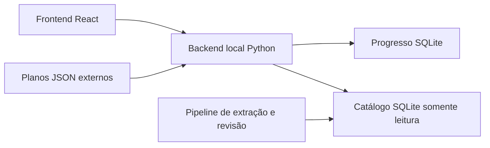

# Sistema de estudo para concursos

Aplicativo local para organizar aulas, resolver questões e provas completas e acompanhar revisões. A interface usa React/Vite; o backend Python usa SQLite para o progresso e consulta um catálogo em somente leitura. PDFs são opcionais e os dados de provas permanecem privados.



## Executar com Docker

Com Docker e Compose 2.20 ou superior, execute na raiz:

```sh
docker compose up --build
```

Acesse <http://127.0.0.1:8765>. O progresso fica no volume `estudo-dados`. O catálogo fictício é criado na primeira execução; os planos de [plans/](plans/) são montados em runtime, somente para leitura. A imagem contém apenas o aplicativo, o contrato e a interface compilada. Ela não inclui o pipeline, planos nem PDFs.

O plano inicial é `apofp-2026`. `ESTUDO_PLAN` escolhe outro diretório dentro de `plans/`; `ESTUDO_PLANS_DIR` permite montar outra coleção. Essa escolha inicializa apenas bancos novos. Para importar um plano em um banco existente, consulte [planos externos](docs/plan-packs.md).

A biblioteca é opcional: coloque PDFs em `biblioteca-concursos/` ou defina `BIBLIOTECA_DIR` no ambiente do Compose. Ela é montada somente para leitura. Para usar um catálogo privado, execute `docker compose cp caminho/conteudo.sqlite estudo:/app/data/conteudo.sqlite` e `docker compose restart estudo`. Preserve os IDs das ocorrências ao substituir o catálogo.

O catálogo fictício não corresponde automaticamente às aulas. Use **Selecionar do catálogo** em uma aula para criar vínculos. Para vincular um catálogo privado compatível ao plano APOFP, execute `docker compose exec estudo python -m estudo.mapping --apply`. O comando cria backup, preserva vínculos manuais e histórico e registra evidências; substitui apenas vínculos gerados que deixaram de corresponder. Sem `--apply`, gera a auditoria. Outros planos usam seleção manual.

## Execução local

Requisitos: Python 3.10 ou superior, Node.js 22.13 ou superior e pnpm 11.25.0. Crie e ative um ambiente virtual Python. Na raiz:

```sh
make setup
make test
make run
```

`make run` compila a interface em `data/frontend/`, instala o plano apenas quando não existe progresso e inicia <http://127.0.0.1:8765>. `make run PLAN=plans/outro/roadmap.json` escolhe o plano inicial. Para iniciar com banco vazio, execute `python -m estudo` diretamente depois de compilar a interface.

Sem Make, inclusive no Windows, os comandos equivalentes, sempre na raiz, são:

```sh
python -m pip install -e packages/contracts -e packages/pipeline -e packages/estudo/backend -e ".[dev,extract]"
pnpm --dir packages/estudo/frontend install --frozen-lockfile
python -m unittest discover -s tests -v
python -m unittest discover -s packages/pipeline/tests -v
python packages/estudo/backend/tests/run_demo_suite.py
pnpm --dir packages/estudo/frontend test
pnpm --dir packages/estudo/frontend run build
python -m estudo init --plan plans/apofp-2026/roadmap.json
python -m estudo
```

Para desenvolvimento, mantenha o backend em execução e use `pnpm --dir packages/estudo/frontend dev`. O Vite encaminha `/api` à porta 8765. O [launcher PowerShell](tools/iniciar.ps1) também usa o pacote instalado.

`ESTUDO_DATA_DIR` seleciona a pasta de dados (padrão `data/estudo/`). `ESTUDO_DB`, `ESTUDO_CONTENT_DB`, `ESTUDO_DIST_DIR`, `ESTUDO_PLAN_FILE`, `ESTUDO_PORT` e `BIBLIOTECA_DIR` permitem selecionar os recursos explicitamente. Os caminhos padrão são relativos ao diretório de execução, sem depender da posição do pacote instalado. O backend não possui autenticação: execute-o na própria máquina e não exponha sua porta a redes externas.

## Atualização e backup

O volume Docker `estudo-dados` continua sendo usado, com os mesmos arquivos na raiz do volume. Em instalações locais anteriores à reorganização, defina `ESTUDO_DATA_DIR=sistema-estudo/dados` para continuar usando a pasta antiga ou, com o servidor parado, copie todo o conteúdo dela para `data/estudo/`. Inclua o catálogo privado, o registro de perfis e os subdiretórios dos perfis. A refatoração não move nem remove esses dados privados automaticamente.

Execute `python -m estudo backup data/estudo/estudo.sqlite backup.sqlite` para salvar o progresso. Para restaurar, pare o servidor e use `python -m estudo restore backup.sqlite data/estudo/restaurado.sqlite`; selecione-o com `ESTUDO_DB`. Os comandos recusam sobrescrita. Cada perfil e o registro de perfis precisam de backup separado. Migrações numeradas preservam o progresso existente.

## Organização e validação

| Local | Responsabilidade |
| --- | --- |
| [packages/contracts/](packages/contracts/) | JSON Schemas, contrato SQLite e catálogo sintético compartilhados. |
| [packages/pipeline/](packages/pipeline/) | Extração por banca, revisão e geração dos derivados; dependências PDF opcionais. |
| [packages/estudo/backend/](packages/estudo/backend/) | Configuração, API, serviços, repositórios e migrações do progresso. |
| [packages/estudo/frontend/](packages/estudo/frontend/) | React por funcionalidade, componentes compartilhados e cliente da API. |
| [plans/](plans/) | Planos JSON externos, independentes do build da aplicação. |
| [deploy/](deploy/) | Dockerfile e Compose; a entrada Compose na raiz mantém o quickstart. |
| [tools/](tools/) e [tests/](tests/) | Ferramentas do repositório e verificações das fronteiras arquiteturais. |

Dados privados, entradas do pipeline, bancos e builds ficam em `data/`, fora do Git. A biblioteca local também é ignorada. O arquivo privado histórico `concurso_codex`, diretório irmão, permanece separado; a política está na [ADR 0002](docs/adr/0002-public-code-private-data.md).

`make lint` verifica Python, JavaScript, caminhos pessoais, tamanhos e links locais. `make test` executa as regressões sintéticas e as regras de arquitetura. `make test-packages` constrói wheels e verifica CLIs, contratos e migrações fora do checkout. Para E2E, instale o navegador com `pnpm --dir packages/estudo/frontend exec playwright install chromium` e execute `make test-e2e`. A CI repete essas verificações em Linux, macOS e Windows e testa a imagem no Linux.

Consulte a [arquitetura](docs/architecture.md), o [contrato de dados](docs/data-contract.md), o [pipeline](docs/pipeline.md), a [auditoria de dependências](docs/security-dependencies.md), os [planos externos](docs/plan-packs.md) e as [pendências da issue #1](docs/issue-1-status.md). A política dos dados está em [DATA-LICENSE.md](DATA-LICENSE.md); a remoção da árvore atual não os remove do histórico Git.
