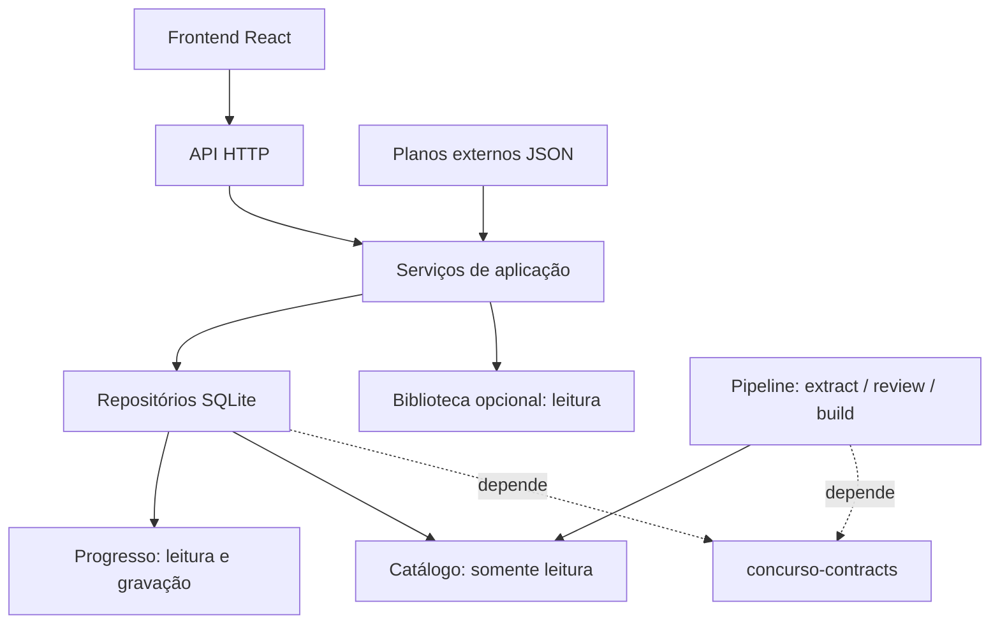

# Arquitetura

O monorepo separa o pipeline, o backend e o frontend em [packages/](../packages/). Planos externos ficam em [plans/](../plans/), infraestrutura em [deploy/](../deploy/) e dados privados e derivados em `data/`, ignorado pelo Git. A [ADR 0004](adr/0004-package-boundaries.md) registra as fronteiras e a migração.

O [backend](../packages/estudo/backend/) é um pacote instalável com layout `src/estudo/`. [app.py](../packages/estudo/backend/src/estudo/app.py) compõe uma instância `Application`, recebendo [Settings](../packages/estudo/backend/src/estudo/config.py). Cada servidor HTTP recebe essa instância explicitamente; não há ligação a `sys.modules`, configuração global mutável de porta nem imports de módulos soltos na raiz. Os caminhos são resolvidos por execução, a partir do ambiente ou de configurações fornecidas diretamente.

[api/http.py](../packages/estudo/backend/src/estudo/api/http.py) declara as rotas e adapta parâmetros, JSON, status, arquivos e intervalos HTTP. [services/](../packages/estudo/backend/src/estudo/services/) valida e executa os casos de uso de aulas, sessões, correção, revisão espaçada, planos e perfis. [repositories/](../packages/estudo/backend/src/estudo/repositories/) contém SQL e persistência. Os serviços controlam transações; [db/](../packages/estudo/backend/src/estudo/db/) controla conexões, backup e migrações. A escolha de questões para prática fica no serviço de seleção, com prioridade para conteúdos distintos e corrigíveis ainda não respondidos.

Erros de domínio são tratados em um único lugar: validação retorna 400, recursos ausentes 404, conflito SQLite 409 e método inválido 405. Erros internos são registrados e retornam mensagem genérica com status 500. O perfil usa contexto isolado por requisição; o endereço local permitido usa a porta efetiva do servidor. `ESTUDO_QUIET=1` silencia o acesso nos testes.

O [contrato compartilhado](../packages/contracts/) distribui os JSON Schemas, o SQL do catálogo e sua validação, sem depender do backend ou do pipeline. Ambos declaram a mesma versão desse pacote. Recursos são incluídos nos wheels; a produção não procura arquivos em diretórios irmãos do checkout. O backend não importa o pipeline nem suas dependências PDF.

O progresso guarda IDs de ocorrências sem FK entre bancos. O pipeline testa sua estabilidade entre reconsolidações com texto corrigido. Atualizações do catálogo precisam preservar esses IDs; faça backup antes de substituí-lo. As migrações de progresso em [db/migrations/](../packages/estudo/backend/src/estudo/db/migrations/) são numeradas, transacionais e registradas em `schema_migrations` e `PRAGMA user_version`. Migrações publicadas permanecem inalteradas; bancos futuros são recusados e bancos legados recebem o esquema sem perder dados.

O [frontend](../packages/estudo/frontend/) organiza telas em `src/features/{roadmap,session,catalog,library,whiteboard,profiles}/`, componentes em `src/components/` e o cliente HTTP em `src/lib/api.js`. O hook de rascunho e a fila serial de gravação pertencem à funcionalidade de sessão. As etapas vêm de `/api/bootstrap`, usando a definição única do backend. O build gera `data/frontend/`, servido por `ESTUDO_DIST_DIR`.

O Excalidraw carrega sob demanda, com versão exata e fontes locais. Seu transform de build tem guardas para o chunk e o trecho esperado; o E2E abre o quadro e verifica a ausência de chamadas externas. A [ADR 0001](adr/0001-local-runtime.md) documenta a escolha.

O [pipeline](pipeline.md) possui pacote, dependências, CLI e testes próprios. Os módulos de `common/{text,io,paths,ids}.py` têm uma implementação de cada utilitário. `review` produz o snapshot JSONL canônico e `build` gera SQLite, CSV, HTML e relatório. Os lotes privados são preservados separadamente com SHA-256 e proveniência.

Planos são importados em runtime com validação e backup. A imagem não contém planos; Compose monta a coleção externa e instala o plano escolhido apenas em bancos novos. Bancos existentes são migrados no startup, sem repopular nem substituir o progresso. O volume `estudo-dados` conserva os mesmos arquivos; veja a [atualização de instalações locais](../README.md#atualização-e-backup).

[Testes de arquitetura](../tests/test_architecture.py) impedem dependências entre backend e pipeline, SQL em HTTP/serviços e imports dos serviços pelos repositórios. O [smoke de pacotes](../tools/check_packages.py) verifica instalação por wheel fora do checkout. Regressões HTTP verificam também duas aplicações simultâneas com configurações independentes.
