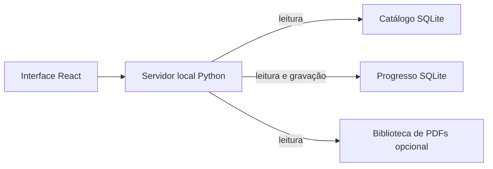

# Arquitetura

O navegador carrega a interface React servida pelo servidor Python local. A API consulta o catálogo SQLite em modo somente leitura; sessões, planos, perfis e revisões são gravados no banco de progresso. PDFs opcionais são lidos de uma biblioteca local restrita. O catálogo padrão é sintético e gerado a partir do esquema versionado. Um catálogo privado pode substituir a demonstração sem sobrescrever o progresso.

O progresso guarda IDs de ocorrências do catálogo sem chave estrangeira entre bancos. Para manter os vínculos, atualizações do catálogo precisam preservar esses IDs. Faça backup do progresso antes de atualizar ou restaurar dados.

O frontend organiza suas telas em `sistema-estudo/src/features/`, com componentes compartilhados em `src/components/`. A configuração das etapas fica em `estudo/config.py` e é enviada ao navegador por `/api/bootstrap`, de modo que os tempos exibidos e os usados pelo servidor tenham a mesma origem.

O esquema do progresso é atualizado pelas migrações SQL em `estudo/db/migrations/`, em ordem numérica. Cada atualização é transacional, registra a versão em `schema_migrations` e `PRAGMA user_version` e preserva os dados existentes. Acrescente novos arquivos numerados sem alterar migrações já publicadas; versões mais recentes que a aplicação são recusadas. Bancos legados com versão zero recebem a migração inicial sem apagar suas tabelas ou registros.
