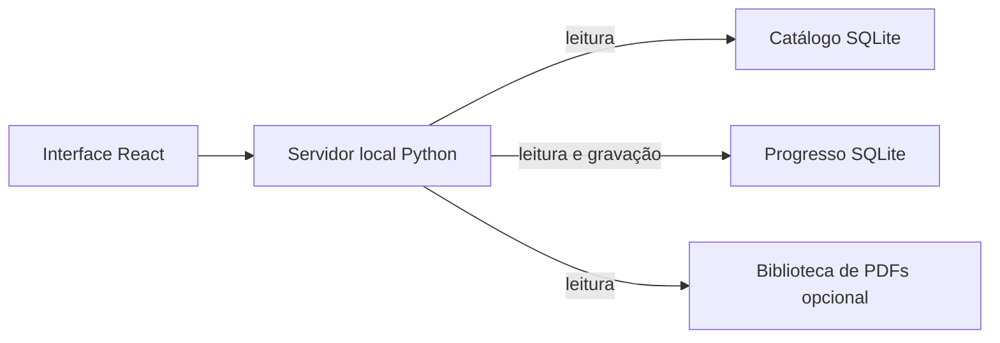

# Arquitetura

O navegador carrega a interface React servida pelo servidor Python local. A API consulta o catálogo SQLite em modo somente leitura; sessões, planos, perfis e revisões são gravados no banco de progresso. PDFs opcionais são lidos de uma biblioteca local restrita. O catálogo padrão é sintético e gerado a partir do esquema versionado. Um catálogo privado pode substituir a demonstração sem sobrescrever o progresso.

O progresso guarda IDs de ocorrências do catálogo sem chave estrangeira entre bancos. Para manter os vínculos, atualizações do catálogo precisam preservar esses IDs. Faça backup do progresso antes de atualizar ou restaurar dados.

O frontend organiza suas telas em `sistema-estudo/src/features/`, com componentes compartilhados em `src/components/`. A configuração das etapas fica em `estudo/config.py` e é enviada ao navegador por `/api/bootstrap`, de modo que os tempos exibidos e os usados pelo servidor tenham a mesma origem.

O esquema do progresso é atualizado pelas migrações SQL em `estudo/db/migrations/`, em ordem numérica. Cada atualização é transacional, registra a versão em `schema_migrations` e `PRAGMA user_version` e preserva os dados existentes. Acrescente novos arquivos numerados sem alterar migrações já publicadas; versões mais recentes que a aplicação são recusadas. Bancos legados com versão zero recebem a migração inicial sem apagar suas tabelas ou registros.

`server.py` compõe as dependências e mantém funções de compatibilidade para os scripts existentes. `estudo/db/connections.py` controla conexões e fechamento; `catalogo/contrato.py` valida os objetos e colunas do catálogo antes de consultá-lo. `estudo/services/{catalog,lessons,sessions}.py` concentra os casos de uso, incluindo correção, conclusão idempotente e revisão espaçada. `estudo/api/http.py` declara a tabela de rotas e adapta HTTP aos serviços. Erros de validação retornam 400, conflitos SQLite retornam 409, rotas ausentes retornam 404 e métodos incorretos retornam 405; erros internos são registrados e retornam uma mensagem genérica com status 500.

O contexto do perfil é isolado por requisição. O endereço permitido é derivado da porta efetiva do servidor, sem alterar uma variável global. O modo silencioso de testes usa `ESTUDO_QUIET=1`.

No frontend, `useSessionDraft` controla o rascunho, o salvamento com atraso e a saída da página. `saveQueue` serializa gravações e impede que respostas antigas substituam o estado mais recente. Há testes JavaScript específicos para concorrência e recuperação de erro. O Excalidraw continua sob demanda, com versão exata e um transform de build restrito para retirar o fallback remoto de fontes; o build falha se o chunk ou o trecho esperado mudar. O E2E abre o quadro e verifica que os recursos carregados são locais. O motivo dessa adaptação está registrado na [ADR](adr/0001-local-runtime.md).

Planos JSON podem ser importados em runtime, conforme [plan packs](plan-packs.md). O plano incluído é um exemplo padrão; campos de título, área, duração e calendário são exibidos a partir dos dados.

O [pipeline](pipeline.md) é um pacote separado do servidor: extratores por banca produzem lotes privados, `review` forma o snapshot JSONL canônico e `build` gera catálogo, CSV, HTML e relatório. Normalização, IO e IDs ficam em `concurso_pipeline/common`. O servidor não executa extrações nem precisa das dependências PDF. O wheel do pipeline inclui os mesmos schemas e SQL versionados usados no checkout.
