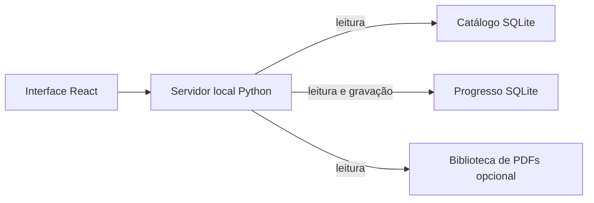

# Arquitetura

O navegador carrega a interface React servida pelo servidor Python local. A API consulta o catálogo SQLite em modo somente leitura; sessões, planos, perfis e revisões são gravados no banco de progresso. PDFs opcionais são lidos de uma biblioteca local restrita. O catálogo padrão é sintético e gerado a partir do esquema versionado. Um catálogo privado pode substituir a demonstração sem sobrescrever o progresso.

O progresso guarda IDs de ocorrências do catálogo sem chave estrangeira entre bancos. Para manter os vínculos, atualizações do catálogo precisam preservar esses IDs. Faça backup do progresso antes de atualizar ou restaurar dados.
